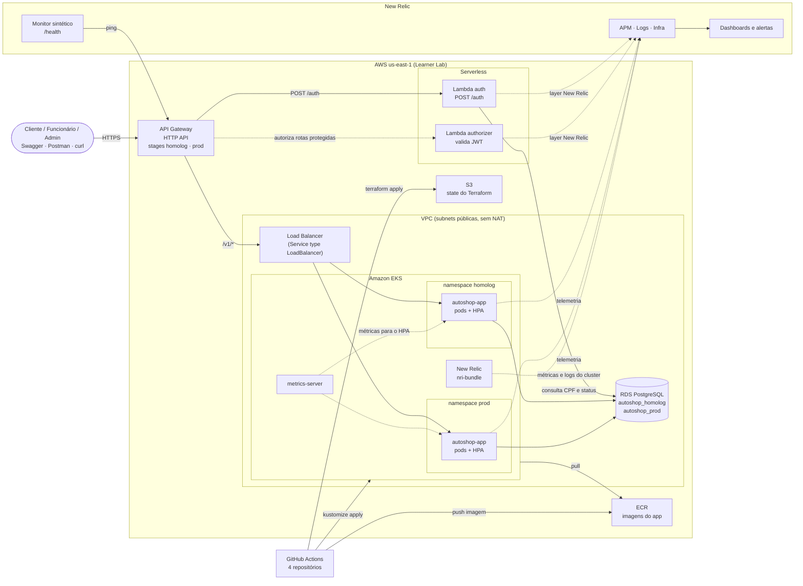

# Diagrama de componentes

**Status:** Rascunho (E0) · versão final na E8, refletindo o que foi implantado

Visão de nuvem, APIs, banco e monitoramento.

## Componentes

| Componente | Responsabilidade | Repositório |
|---|---|---|
| API Gateway (HTTP API) | Entrada única, roteamento, authorizer, throttling | autoshop-auth-lambda |
| Lambda `auth` | Valida CPF, consulta cadastro e status, emite JWT | autoshop-auth-lambda |
| Lambda `authorizer` | Valida JWT e repassa `sub` e `perfil` | autoshop-auth-lambda |
| EKS + HPA + metrics-server | Executa e escala o app | autoshop-infra-k8s |
| autoshop-app | Regras de negócio e API REST `/v1` | autoshop-app |
| RDS PostgreSQL | Persistência (um database por ambiente) | autoshop-infra-db |
| ECR | Registro das imagens do app | autoshop-infra-k8s |
| S3 | State remoto do Terraform | bootstrap (runbook) |
| New Relic | APM, infra, logs, dashboards, alertas, uptime | app + infra-k8s |
| GitHub Actions | CI/CD dos 4 repositórios | todos |

## Pontos a confirmar no spike da E2

- O `Service type: LoadBalancer` cria o LB usando a `LabRole`? Plano B: NodePort (ADR-010).
- A Lambda `auth` consegue rodar na VPC para alcançar o RDS? Plano B: RDS público restrito por security group.
