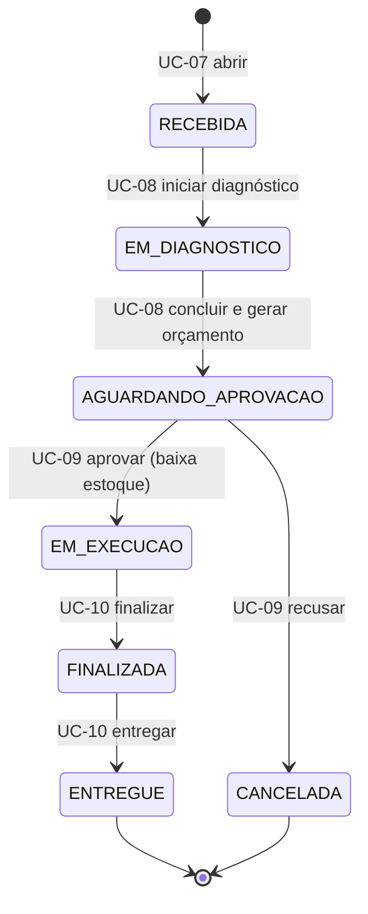

# Casos de uso

**Status:** Catálogo (E0) · **Atualizado em:** 09/10/2026

Este documento tem duas camadas:

1. **Catálogo (E0):** ator, pré-condições, fluxo principal, exceções e regras de cada UC.
2. **Critérios de aceite (na etapa que implementa o UC):** cenários Dado/Quando/Então, numerados `CA1`, `CA2`… Cada cenário vira um teste com o nome `test_ucXX_caY`.

| UC | Nome | Ator principal | Critérios escritos na |
|---|---|---|---|
| [UC-01](#uc-01--autenticar-por-cpf) | Autenticar por CPF | Cliente, Funcionário, Admin | E6 |
| [UC-02](#uc-02--acessar-rota-protegida) | Acessar rota protegida | Qualquer usuário autenticado | E6 |
| [UC-03](#uc-03--gerir-clientes) | Gerir clientes | Funcionário | E1 |
| [UC-04](#uc-04--gerir-veículos) | Gerir veículos | Funcionário | E1 |
| [UC-05](#uc-05--gerir-catálogo-de-serviços) | Gerir catálogo de serviços | Admin | E1 |
| [UC-06](#uc-06--gerir-peças-e-estoque) | Gerir peças e estoque | Admin | E1 |
| [UC-07](#uc-07--abrir-ordem-de-serviço) | Abrir ordem de serviço | Funcionário | E1 |
| [UC-08](#uc-08--diagnosticar-e-gerar-orçamento) | Diagnosticar e gerar orçamento | Funcionário | E1 |
| [UC-09](#uc-09--aprovar-ou-recusar-orçamento) | Aprovar ou recusar orçamento | Cliente | E1 |
| [UC-10](#uc-10--executar-finalizar-e-entregar-os) | Executar, finalizar e entregar OS | Funcionário | E1 |
| [UC-11](#uc-11--acompanhar-os) | Acompanhar OS | Cliente, Funcionário | E4 |
| [UC-12](#uc-12--consultar-indicadores-de-os) | Consultar indicadores de OS | Admin | E4 |

## Regras de negócio

| ID | Regra |
|---|---|
| RN-01 | CPF e CNPJ são válidos só se os dígitos verificadores conferem. Documentos com todos os dígitos iguais são inválidos. |
| RN-02 | O documento (CPF ou CNPJ) é único entre clientes. |
| RN-03 | A placa segue o padrão antigo (`AAA9999`) ou o Mercosul (`AAA9A99`) e é única. |
| RN-04 | Todo veículo pertence a exatamente um cliente. |
| RN-05 | Cliente `INATIVO` não autentica e não pode ter OS aberta. Clientes são inativados, nunca apagados. |
| RN-06 | Uma OS exige cliente ativo e um veículo desse cliente. |
| RN-07 | A OS só muda de status pelas transições da [máquina de estados](#máquina-de-estados-da-os). Cada transição grava status de origem, destino, data/hora e autor. |
| RN-08 | Orçamento = Σ(preço do serviço × qtd) + Σ(preço da peça × qtd). Os preços ficam congelados na OS no momento da inclusão. |
| RN-09 | O estoque de uma peça nunca fica negativo. A baixa acontece na entrada em `EM_EXECUCAO` (Q7). |
| RN-10 | Serviços e peças da OS só podem ser alterados em `RECEBIDA` ou `EM_DIAGNOSTICO`. |
| RN-11 | O cliente só enxerga e só aprova as próprias OS. |
| RN-12 | Toda falha no processamento de uma OS gera log de erro estruturado com `request_id` e o id da OS. É a base do alerta. |

## Máquina de estados da OS

Visão resumida. O detalhamento fica em `docs/dominio/maquina-estados-os.md` (E1).

---

## UC-01 — Autenticar por CPF

- **Ator:** Cliente, Funcionário ou Admin (via função serverless)
- **Pré-condição:** nenhuma
- **Fluxo principal**
  1. O usuário envia o CPF para `POST /auth`.
  2. A função valida o formato e os dígitos do CPF (RN-01).
  3. A função procura o CPF entre funcionários e, se não achar, entre clientes.
  4. A função confere se o cadastro está `ATIVO` (RN-05).
  5. A função devolve um JWT com `sub` (id), `perfil` e `exp`.
- **Exceções**
  - CPF malformado ou com dígitos inválidos → 400
  - CPF não cadastrado → 401
  - Cadastro inativo → 401 (a resposta não revela o motivo)
- **Pós-condição:** o usuário tem um token válido para as rotas protegidas
- **Regras:** RN-01, RN-05

## UC-02 — Acessar rota protegida

- **Ator:** usuário autenticado (via authorizer do API Gateway)
- **Pré-condição:** UC-01 concluído
- **Fluxo principal**
  1. O usuário chama uma rota protegida com `Authorization: Bearer <jwt>`.
  2. O authorizer valida a assinatura e a expiração.
  3. O Gateway repassa a requisição ao app, com `sub` e `perfil` no contexto.
  4. O app confere se o perfil pode usar a rota e responde.
- **Exceções**
  - Sem token, token inválido ou expirado → 401
  - Perfil sem permissão → 403
- **Regras:** RN-11

## UC-03 — Gerir clientes

- **Ator:** Funcionário
- **Fluxo principal:** cadastrar (nome, documento, e-mail, telefone) → consultar por id ou documento → atualizar dados de contato → inativar.
- **Exceções**
  - Documento inválido → 422
  - Documento já cadastrado → 409
  - Cliente inexistente → 404
- **Regras:** RN-01, RN-02, RN-05

## UC-04 — Gerir veículos

- **Ator:** Funcionário
- **Pré-condição:** cliente cadastrado e ativo
- **Fluxo principal:** cadastrar (placa, marca, modelo, ano) vinculado a um cliente → listar veículos do cliente → atualizar → remover (só se não houver OS vinculada).
- **Exceções**
  - Placa inválida → 422
  - Placa já cadastrada → 409
  - Veículo com OS vinculada → 409 ao remover
- **Regras:** RN-03, RN-04

## UC-05 — Gerir catálogo de serviços

- **Ator:** Admin
- **Fluxo principal:** cadastrar (nome, descrição, preço) → listar → atualizar preço ou descrição → desativar.
- **Exceções:** preço ≤ 0 → 422
- **Observação:** mudar o preço não altera OS já abertas (RN-08)

## UC-06 — Gerir peças e estoque

- **Ator:** Admin
- **Fluxo principal:** cadastrar peça (nome, código, preço, quantidade inicial) → listar com saldo → registrar entrada de estoque → atualizar preço.
- **Exceções:** preço ≤ 0 ou quantidade negativa → 422
- **Regras:** RN-08, RN-09

## UC-07 — Abrir ordem de serviço

- **Ator:** Funcionário
- **Pré-condição:** cliente ativo com veículo cadastrado
- **Fluxo principal**
  1. O funcionário informa o documento do cliente, o veículo e os serviços solicitados (e peças, se já forem conhecidas).
  2. O sistema valida o cliente e o veículo (RN-06).
  3. O sistema cria a OS em `RECEBIDA`, congela os preços e grava a primeira entrada do histórico de status.
- **Exceções**
  - Cliente inativo ou inexistente → 422
  - Veículo de outro cliente → 422
  - Serviço ou peça inexistente → 422
- **Pós-condição:** a OS aparece na listagem de OS ativas e conta no volume diário
- **Regras:** RN-06, RN-07, RN-08

## UC-08 — Diagnosticar e gerar orçamento

- **Ator:** Funcionário
- **Pré-condição:** OS em `RECEBIDA`
- **Fluxo principal**
  1. O funcionário inicia o diagnóstico (→ `EM_DIAGNOSTICO`).
  2. O funcionário ajusta serviços e peças conforme a avaliação (RN-10).
  3. O funcionário conclui o diagnóstico.
  4. O sistema calcula o orçamento e muda a OS para `AGUARDANDO_APROVACAO`.
- **Exceções**
  - Transição fora de ordem → 409
  - Concluir sem nenhum serviço → 422
- **Regras:** RN-07, RN-08, RN-10

## UC-09 — Aprovar ou recusar orçamento

- **Ator:** Cliente (dono da OS)
- **Pré-condição:** OS em `AGUARDANDO_APROVACAO`
- **Fluxo principal (aprovar)**
  1. O cliente consulta o orçamento.
  2. O cliente aprova.
  3. O sistema dá baixa no estoque das peças e muda a OS para `EM_EXECUCAO`.
- **Fluxo alternativo (recusar):** o cliente recusa e a OS vai para `CANCELADA` (Q1).
- **Exceções**
  - OS de outro cliente → 403
  - OS em outro status → 409
  - Estoque insuficiente → 409, a OS continua aguardando e o erro é logado (RN-12)
- **Regras:** RN-07, RN-09, RN-11, RN-12

## UC-10 — Executar, finalizar e entregar OS

- **Ator:** Funcionário
- **Fluxo principal:** com a OS em `EM_EXECUCAO`, o funcionário finaliza (→ `FINALIZADA`); quando o cliente retira o veículo, registra a entrega (→ `ENTREGUE`).
- **Exceções:** transição fora de ordem → 409
- **Pós-condição:** os tempos de execução e finalização ficam disponíveis para o UC-12
- **Regras:** RN-07

## UC-11 — Acompanhar OS

- **Ator:** Cliente ou Funcionário
- **Fluxo principal**
  - **Cliente:** lista as próprias OS e vê o detalhe (status atual, orçamento e histórico de status).
  - **Funcionário:** lista as OS ativas na ordem de prioridade (Q4) e vê o detalhe de qualquer OS.
- **Exceções**
  - OS inexistente → 404
  - Cliente consultando OS de outro cliente → 404 (não revela que ela existe)
- **Regras:** RN-11

## UC-12 — Consultar indicadores de OS

- **Ator:** Admin (e o dashboard do New Relic, na E7)
- **Fluxo principal:** informar um período e receber o volume diário de OS abertas e o tempo médio em `EM_DIAGNOSTICO`, `EM_EXECUCAO` e `FINALIZADA`.
- **Exceções:** período inválido (início depois do fim) → 422
- **Regras:** RN-07 (os tempos vêm do histórico de status)
